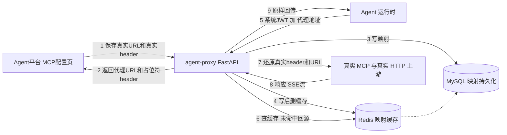
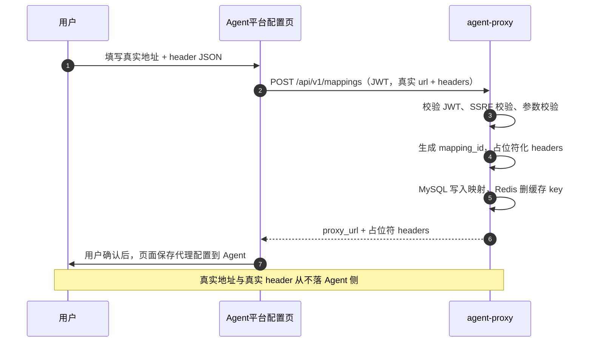
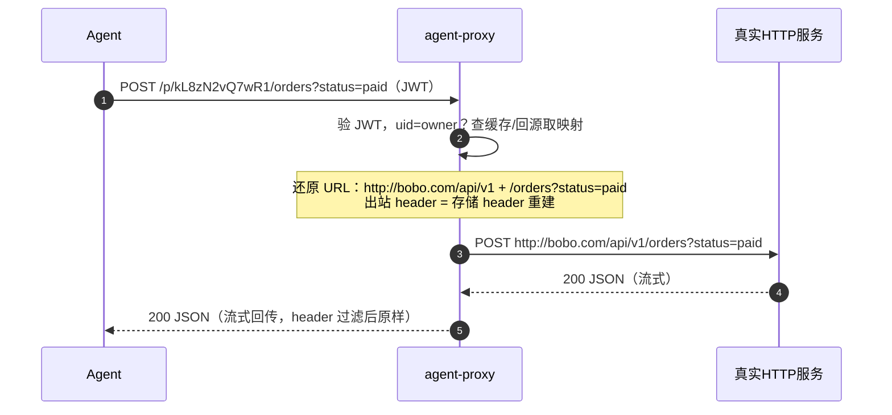
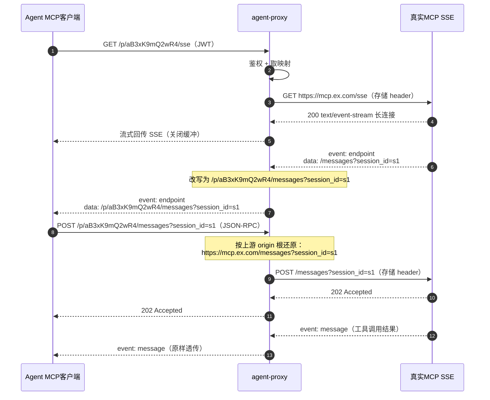
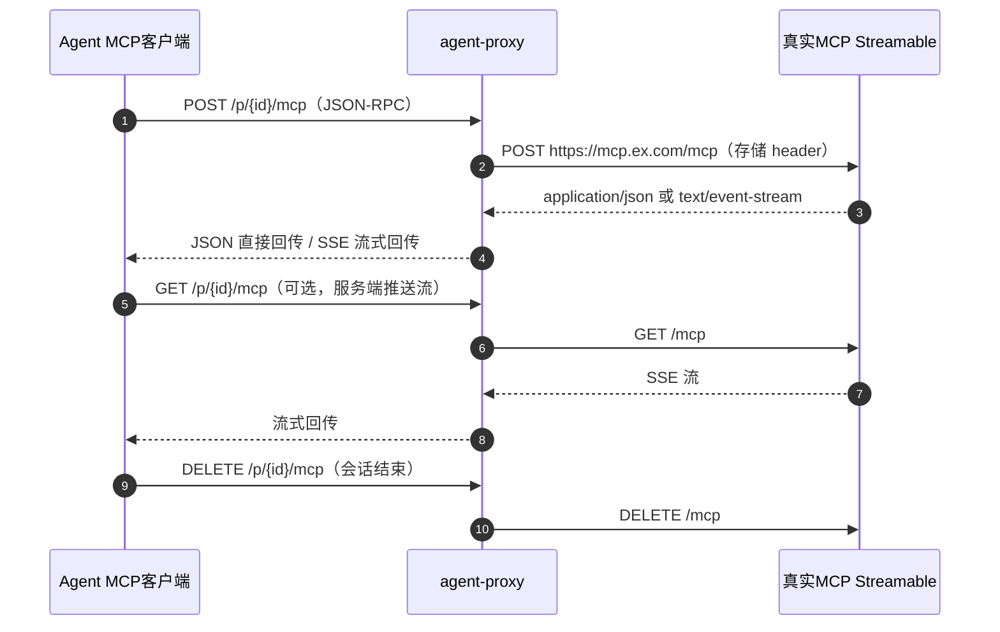

# agent-proxy 首期设计文档（MCP / HTTP 代理）

| | |
|---|---|
| 日期 | 2026-11-21 |
| 状态 | 已评审（设计决策见附录 A） |
| 范围 | 一期：HTTP 前缀代理 + MCP（SSE / Streamable HTTP）代理 |

---

## 1. 背景与目标

### 1.1 背景

Agent 平台的用户需要接入外部 MCP 服务与 HTTP API。如果让 Agent 直接持有外部真实地址与凭据（API Key 等），会带来：

- **凭据泄露风险**：真实地址、密钥落地在 Agent 配置中，可见可导出；
- **无法统一管控**：平台无法审计、禁用、收回某个外部依赖；
- **凭据与用户绑定缺失**：外部调用无法追溯到平台用户。

因此引入 **agent-proxy**：所有 Agent 对外访问一律经代理转发，真实地址与凭据只存在于代理侧。

### 1.2 一期目标

1. **HTTP 代理**：前缀映射，任意子路径 / query / body / method 流式透传；
2. **MCP 代理**：支持 **SSE** 与 **Streamable HTTP** 两种远程传输，含 endpoint 事件改写；
3. **注册机制**：用户在 Agent 页面保存前，先调代理注册接口保存真实地址 + 真实 header；代理返回代理地址 + 占位符 header，Agent 侧只保存后者；
4. **鉴权**：全部接口使用系统 JWT；映射**仅注册者本人可调用**。

### 1.3 非目标（一期不做）

- MCP stdio 传输（本服务只做远程传输代理）；
- 限流、配额；
- 「按调用者动态替换 header 值」「可配置用户信息注入 header」（当前确认：仅还原注册者存储的 header）；
- Web 管理界面；
- 上游 OAuth 鉴权；
- 多实例缓存失效广播（Redis pub/sub）；
- Prometheus 指标监控。

---

## 2. 术语与核心概念

| 术语 | 含义 |
|---|---|
| **映射（Mapping）** | 一条注册记录：`mapping_id → 归属用户 + 真实上游地址 + 真实 header`，代理转发的依据 |
| **mapping_id** | 注册时生成的随机 base62 串（12 位，约 71 bit 熵），是路由前缀，不含任何真实地址信息 |
| **代理地址（proxy_url）** | Agent 实际保存和调用的地址，形如 `{EXTERNAL_BASE}/p/{mapping_id}/...` |
| **占位符** | 返回给 Agent 的 header 值，格式 `${PX:<header名>}`，仅起脱敏展示作用 |
| **上游（upstream）** | 真实的 MCP 服务或 HTTP API |

---

## 3. 总体架构



要点：

- 真实地址与真实 header **只存在于 proxy 侧**（MySQL + Redis），Agent 侧只有代理地址与占位符；
- 代理进程**无会话状态**：SSE 会话状态由上游 MCP 自持（session_id 在 URL / header 中回传），代理可水平扩展；
- 流式全程不缓冲：响应体、SSE 事件增量转发。

---

## 4. 配置流程（注册）



**示例（MCP）**

```
POST /api/v1/mappings
{
  "type": "mcp",
  "upstream_url": "https://mcp.ex.com/sse",
  "headers": { "Authorization": "Bearer sk-abc123", "X-User-Id": "u888" }
}

HTTP 201
{
  "mapping_id": "aB3xK9mQ2wR4",
  "proxy_url": "https://agent-prox.com/p/aB3xK9mQ2wR4/sse",
  "headers": { "Authorization": "${PX:Authorization}", "X-User-Id": "${PX:X-User-Id}" }
}
```

**示例（HTTP 前缀）**

```
POST /api/v1/mappings
{ "type": "http", "upstream_url": "http://bobo.com/api/v1", "headers": {} }

HTTP 201
{ "mapping_id": "kL8zN2vQ7wR1", "proxy_url": "https://agent-prox.com/p/kL8zN2vQ7wR1", "headers": {} }

之后: GET /p/kL8zN2vQ7wR1/orders?id=1  →  http://bobo.com/api/v1/orders?id=1
```

---

## 5. 数据模型

### 5.1 MySQL（持久化）

```sql
CREATE TABLE proxy_mapping (
  id               BIGINT UNSIGNED AUTO_INCREMENT PRIMARY KEY,
  mapping_id       VARCHAR(16)  NOT NULL COMMENT '对外路由标识，随机 base62',
  owner_uid        VARCHAR(64)  NOT NULL COMMENT '注册者 uid，来自 JWT',
  type             ENUM('http','mcp') NOT NULL,
  upstream_url     VARCHAR(2048) NOT NULL COMMENT 'http: 前缀URL；mcp: 端点URL',
  upstream_headers JSON         NOT NULL COMMENT '真实 header，可选应用层加密',
  status           ENUM('active','disabled') NOT NULL DEFAULT 'active',
  created_at       DATETIME     NOT NULL DEFAULT CURRENT_TIMESTAMP,
  updated_at       DATETIME     NOT NULL DEFAULT CURRENT_TIMESTAMP ON UPDATE CURRENT_TIMESTAMP,
  UNIQUE KEY uk_mapping_id (mapping_id),
  KEY idx_owner_uid (owner_uid)
) ENGINE=InnoDB DEFAULT CHARSET=utf8mb4 COMMENT='代理映射表';
```

说明：

- `mapping_id` 由 `secrets` 模块生成（base62，12 位），冲突时重试；
- `upstream_headers` 存真实 header 键值对；当 `ENCRYPT_AT_REST=on` 时整体 AES-GCM（Fernet）加密后存入（密钥经环境变量 `MASTER_KEY` 注入）。

### 5.2 Redis（缓存，cache-aside）

| 项 | 设计 |
|---|---|
| key | `ap:mapping:{mapping_id}` |
| value | 映射记录 JSON（含 id、owner_uid、type、upstream_url、upstream_headers、status） |
| TTL | 300 秒 |
| 读 | GET → 命中直接返回；未命中查 MySQL → `SETEX` 回填 |
| 写 | MySQL 落库成功后 `DEL` 缓存 key |
| 降级 | Redis 连接异常时直接回源 MySQL，记 WARN 日志，不影响可用性 |

**一致性**：写时删缓存 + TTL 兜底。多实例部署时，其他实例最多在 TTL 周期内读到旧值；二期可加 Redis pub/sub 失效广播。

---

## 6. API 设计

### 6.1 管理接口（前缀 `/api/v1/mappings`，全部要求系统 JWT）

| 方法 | 路径 | 说明 |
|---|---|---|
| POST | `/api/v1/mappings` | 注册映射，返回代理地址 + 占位符 header |
| GET | `/api/v1/mappings` | 当前用户的映射列表（分页） |
| GET | `/api/v1/mappings/{mapping_id}` | 映射详情，**真实值仅注册者可见** |
| PUT | `/api/v1/mappings/{mapping_id}` | 更新 upstream_url / headers / status，成功后删缓存 |
| DELETE | `/api/v1/mappings/{mapping_id}` | 删除映射，成功后删缓存 |

**注册参数校验规则**

| 字段 | 规则 |
|---|---|
| `type` | 必填，`http` 或 `mcp` |
| `upstream_url` | 必填；scheme 仅 http/https；host 必填；mcp 类型建议为完整端点（如 `.../sse`、`.../mcp`） |
| `headers` | 可选 object；键名须为合法 header 名（RFC 7230 token）；值必须为字符串；数量 ≤ 32，单值长度 ≤ 4KB |

**响应码**：201 成功；400 参数非法；401 JWT 无效。非注册者操作他人映射 → 404（不暴露存在性）。

### 6.2 代理端点

```
ANY /p/{mapping_id}/{path}          # path 可为空；query 透传
```

**代理地址（proxy_url）拼装规则**

```
proxy_url = {EXTERNAL_BASE}/p/{mapping_id} [ + upstream_path ]    # mcp 类型附加端点路径，如 /sse
```

`EXTERNAL_BASE` 为配置项（网关后的对外域名），保证返回的代理地址可直接使用。

### 6.3 占位符规范

- 格式：`${PX:<header名>}`，如 `${PX:Authorization}`；
- 生成：注册响应中，对每个真实 header 的 value 生成同名占位符（**同 key 不同值**）；
- 还原：转发时**按 key 从存储直接取真实值**重建出站 header，占位符内容不参与任何解析；
- Agent 即使把占位 header 原样发回，代理也一律丢弃（见 8.1），不构成泄露或伪造通道。

---

## 7. 鉴权设计（系统 JWT）

| 项 | 设计 |
|---|---|
| 携带方式 | `Authorization: Bearer <token>` |
| 算法 | HS256 + 共享密钥（环境变量 `JWT_SECRET`，与 Agent 平台同源）；预留 RS256 / JWKS 演进 |
| claims | `uid`（必须）、`exp`（必须）、`iat`、`tenant_id` / `name`（可选，仅用于审计） |
| 校验 | 验签 + exp（leeway 60 秒）；代理不刷新、不下发 token |
| 代理侧用途 | ① 管理接口：uid 归属校验；② 代理端点：uid = `owner_uid` 才放行 |
| **不透传** | **调用者的 JWT 绝不转发给上游**（见 8.1） |

错误：JWT 缺失 / 无效 / 过期 → `401`；uid ≠ owner_uid → `403`。

---

## 8. 转发设计

### 8.1 通用规则

1. **出站 header 重建**（安全核心）：出站请求 header = **存储的 upstream_headers 全量** + 协议必要 header（`Accept`、`Content-Type`、`Content-Length`，MCP 的 `Mcp-Session-Id` / `Last-Event-ID` / `MCP-Protocol-Version` 白名单透传）。调用方请求中的其余 header（含其 JWT、占位 header）**一律不透传**；hop-by-hop header（`Connection`、`Keep-Alive`、`Transfer-Encoding`、`TE`、`Trailer`、`Proxy-*`、`Upgrade`）排除。
2. **流式**：请求 body 与响应 body 均以异步流转发（httpx stream），不落盘、不整体驻留内存；响应不限大小，请求体默认上限 10MB（可配）。
3. **响应 header 过滤**：剥离 hop-by-hop 后原样回传（`Content-Type` 等），绝不含存储的真实 header。
4. **客户端断开**：立即取消上游流并释放连接。
5. **超时**（可配）：

| 场景 | connect | read |
|---|---|---|
| 普通 HTTP 转发 | 10s | 60s |
| SSE 长连接 | 10s | 不设（依赖心跳保活） |
| Streamable 流式响应 | 10s | 不设 |

6. **重试**：一期不自动重试（避免非幂等请求重复触发）。

### 8.2 HTTP 前缀映射

```
转发URL = upstream_url(规范化去尾斜杠) + "/" + 子路径 + "?" + query
```



### 8.3 MCP — SSE 传输

关键点：SSE `endpoint` 事件改写 + 后续 POST 按上游 **origin 根**还原路径。

**路径分发规则（mcp 类型）**

| 请求路径 | 转发目标 |
|---|---|
| `/p/{id}` + 注册端点路径（如 `sse`） | 完整注册 upstream_url（初始连接） |
| `/p/{id}` + 其他任意路径 | **上游 origin 根** + 该路径（messages 端点等） |

**endpoint 事件改写规则**：增量解析 SSE 流；遇到 `event: endpoint` 的 `data:` 行——若值为绝对 URL 或路径，取其 path + query，改写为 `data: /p/{id}<path>?<query>` 下发；其余事件字节级原样透传。



限制说明：仅支持根相对路径形式的 endpoint 事件（官方 Python / TypeScript SDK 均为此形式）；客户端断开即取消上游连接。代理不保存会话状态，session_id 由上游通过 URL 自持。

### 8.4 MCP — Streamable HTTP

单一端点，无需改写：



`Mcp-Session-Id` 经白名单透传，会话状态由上游自持。

---

## 9. 安全设计

| # | 措施 | 说明 |
|---|---|---|
| 1 | JWT 鉴权 | 管理与代理端点全覆盖；仅注册者可调用（403） |
| 2 | 防凭据泄露 | `/p/*` 响应永不回显真实 header；出站 header 从存储重建；详情接口真实值仅注册者可见 |
| 3 | SSRF 防护 | 注册时校验 scheme（仅 http/https）；解析域名并拒绝私网 / 环回 / 链路本地地址段（`10/8`、`172.16/12`、`192.168/16`、`127/8`、`169.254/16`、`::1` 等）；可用 `SSRF_ALLOW_PRIVATE=true` 放开（内联调环境） |
| 4 | 参数加固 | header 键名合法性校验、数量与长度上限、请求体大小上限 |
| 5 | 审计日志 | 记录 uid、mapping_id、method、path、status、耗时、上下行字节数、client_ip；**不含任何 header 值** |
| 6 | 落库加密 | `ENCRYPT_AT_REST=on` 时 upstream_headers 以 AES-GCM 加密存储（`MASTER_KEY` 环境变量） |
| 7 | TLS | 由网关 / 负载均衡终结，代理服务部署在内网 |
| 8 | 已知残留风险 | DNS rebinding（注册时校验、请求时重新解析）一期不做强防护，列入二期 |

---

## 10. 错误处理

统一错误体：`{"code": "<CODE>", "message": "<人类可读描述>"}`

| 场景 | HTTP | code |
|---|---|---|
| JWT 缺失 / 无效 / 过期 | 401 | `INVALID_TOKEN` |
| 非注册者调用 / 操作 | 403（代理端点）/ 404（管理接口，隐藏存在性） | `FORBIDDEN` / `MAPPING_NOT_FOUND` |
| 映射不存在或已禁用 | 404 | `MAPPING_NOT_FOUND` |
| 注册 / 更新参数非法 | 400 | `INVALID_PARAM` |
| 上游连接失败 | 502 | `UPSTREAM_ERROR` |
| 上游超时 | 504 | `UPSTREAM_TIMEOUT` |
| 请求体超限 | 413 | `BODY_TOO_LARGE` |
| 上游 4xx / 5xx | 原样透传状态码与响应体 | — |

上游错误响应**原样透传**给 Agent（保留状态码），代理仅在自身故障时产生 502/504。

---

## 11. 日志规范

遵循全局规范（按天滚动 + 单文件 50MB 立即滚动 + 保留 7 天 + 同一文件全局仅一个滚动 handler，后缀精确到秒防同日覆盖）：

- `logs/agent-proxy.log`：运行日志（DEBUG/INFO）；
- `logs/audit.log`：审计日志（JSON 行，见 9.5 字段）；
- 敏感信息（真实 header、JWT、上游响应体）一律不打日志。

---

## 12. 技术栈与项目结构

| 项 | 选择 |
|---|---|
| 语言 / 运行时 | Python 3.12（`D:\Python312\python.exe -m venv .venv`，依赖只装 venv） |
| Web 框架 | FastAPI + uvicorn（异步） |
| 上游调用 | httpx（异步、流式） |
| ORM / 驱动 | SQLAlchemy 2（async）+ aiomysql |
| 缓存 | redis-py（async） |
| JWT | PyJWT |
| 落库加密 | cryptography（Fernet，可选） |
| 测试 | pytest + pytest-asyncio |

```
agent-proxy/
├── docs/superpowers/specs/          # 设计文档
├── src/agent_proxy/
│   ├── main.py                      # FastAPI 组装、生命周期
│   ├── config.py                    # 环境配置
│   ├── auth.py                      # JWT 校验依赖
│   ├── db.py                        # MySQL engine / session
│   ├── cache.py                     # Redis cache-aside
│   ├── models.py                    # ORM: ProxyMapping
│   ├── schemas.py                   # Pydantic 请求/响应模型
│   ├── placeholder.py               # 占位符化 / 还原
│   ├── mapping_id.py                # 随机 ID 生成
│   ├── ssrf.py                      # 上游地址校验
│   ├── headers.py                   # 出站 header 重建 / hop-by-hop 过滤
│   ├── logging_setup.py             # 滚动日志（全局规范）
│   ├── api/
│   │   ├── mgmt.py                  # /api/v1/mappings 管理接口
│   │   └── proxy.py                 # /p/{mapping_id}/{path} 转发入口
│   └── forward/
│       ├── http_forward.py          # HTTP 前缀流式转发
│       ├── mcp_sse.py               # SSE 长连接 + endpoint 改写
│       └── mcp_streamable.py        # Streamable HTTP 透传
├── tests/
│   ├── unit/                        # 单元测试
│   └── integration/                 # mock 上游全链路
├── pyproject.toml
├── .env.example
└── README.md
```

**配置项（环境变量）**

| 变量 | 说明 | 默认 |
|---|---|---|
| `AGENT_PROXY_LISTEN` | 监听地址 | `0.0.0.0:8800` |
| `EXTERNAL_BASE` | 对外域名，用于拼 proxy_url | 必填 |
| `JWT_SECRET` | HS256 共享密钥 | 必填 |
| `MYSQL_DSN` | MySQL 连接串 | 必填 |
| `REDIS_URL` | Redis 连接串 | 必填 |
| `CACHE_TTL` | 映射缓存 TTL（秒） | `300` |
| `UPSTREAM_CONNECT_TIMEOUT` / `UPSTREAM_READ_TIMEOUT` | 上游超时（秒） | `10` / `60` |
| `MAX_BODY_SIZE` | 请求体上限 | `10MB` |
| `SSRF_ALLOW_PRIVATE` | 允许内网上游（联调用） | `false` |
| `ENCRYPT_AT_REST` / `MASTER_KEY` | 落库加密 | `false` / 必填(当开启) |
| `LOG_DIR` / `LOG_LEVEL` | 日志目录 / 级别 | `logs` / `INFO` |

---

## 13. 测试策略

| 层级 | 内容 |
|---|---|
| 单元 | 占位符化/还原、URL 拼接与规范化、路径分发、endpoint 事件改写、JWT 校验、SSRF 校验、header 重建与过滤 |
| 集成 | pytest + mock 上游（普通 HTTP echo / SSE / Streamable）走全链路：注册 → 占位符校验 → 调用 → 用 echo 验证转发 URL 与出站 header 与存储一致；权限用例（无 token 401、他人 403、禁用 404）|
| 真实客户端 | MCP Inspector（`npx @modelcontextprotocol/inspector`）分别以 SSE 与 Streamable 连接代理，完成 tools/list 与 tools/call |
| 缓存 | 命中 / 未命中回源 / 写后失效 / Redis 停机降级 |

---

## 14. 里程碑

| 阶段 | 内容 | 验收 |
|---|---|---|
| M1 | 骨架 + 配置/日志/JWT + 管理接口 + MySQL/Redis | 注册返回代理地址与占位符；缓存读写与失效正确 |
| M2 | HTTP 前缀流式转发 | echo 上游全链路验证；大文件流式不驻留内存 |
| M3 | MCP SSE + endpoint 改写 | Inspector 以 SSE 传输完成 tools/call |
| M4 | MCP Streamable | Inspector 以 Streamable 完成 tools/call |
| M5 | 集成测试补全 + README + 联调 | 全部测试通过 |

**二期演进**：限流与配额（Redis 计数）、多实例缓存失效广播、可配置的用户信息注入 header、Web 管理界面、上游 OAuth、指标监控、DNS rebinding 强防护。

---

## 附录 A：设计决策记录

| 决策点 | 结论 |
|---|---|
| 路由方案 | 路径携带映射 ID：`/p/{mapping_id}/...`（单域名，无泛 DNS 要求） |
| 占位符语义 | 用户填写 header 的**所有 value** 都替换占位符，纯脱敏；调用时全部从存储还原 |
| 转发 header 构成 | 仅还原存储的原始 header；调用者 JWT 只做代理侧鉴权，不透传上游 |
| 系统令牌 | JWT 自包含（HS256），uid 取自 claims |
| HTTP 映射粒度 | 前缀映射（注册一次覆盖同前缀全部接口） |
| MCP 传输 | SSE + Streamable HTTP |
| 调用权限 | 仅注册者本人 |
| 存储 | MySQL 持久化 + Redis 缓存（cache-aside，TTL 300s，写时删缓存） |
| 技术栈 | Python 3.12 + FastAPI + httpx + uvicorn |
| 注册接口鉴权 | 系统 JWT |
