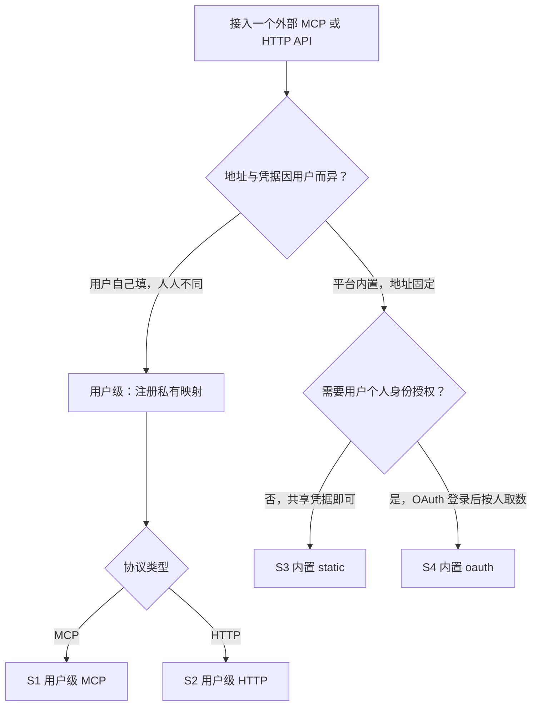
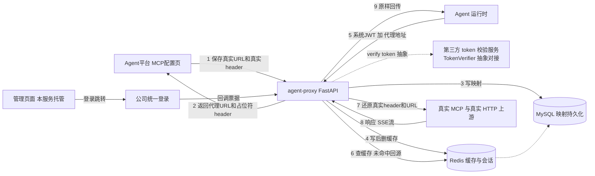
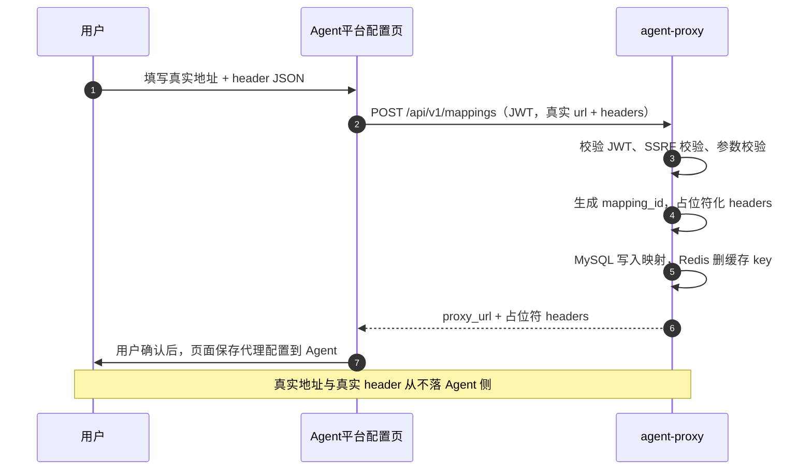
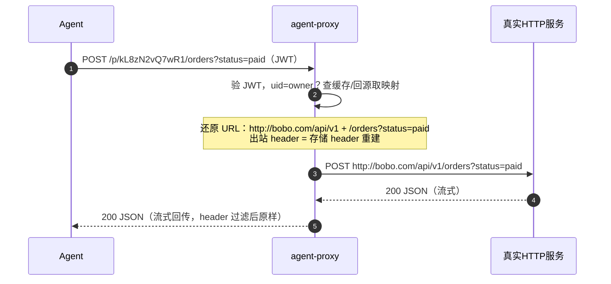
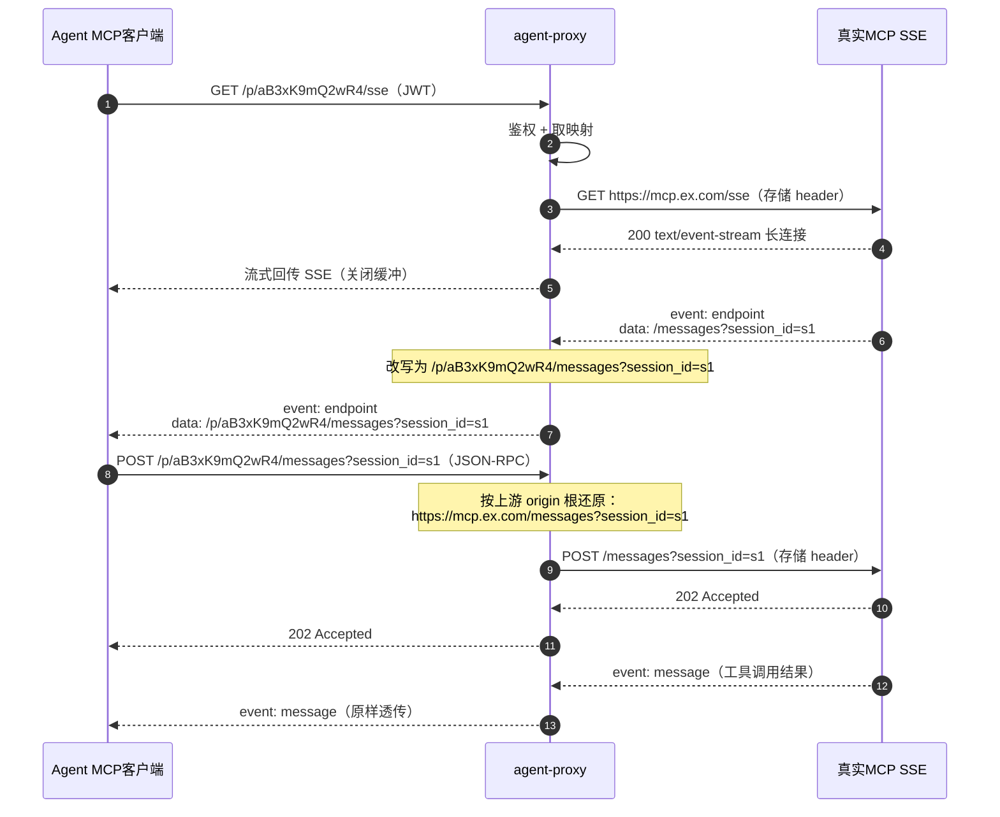
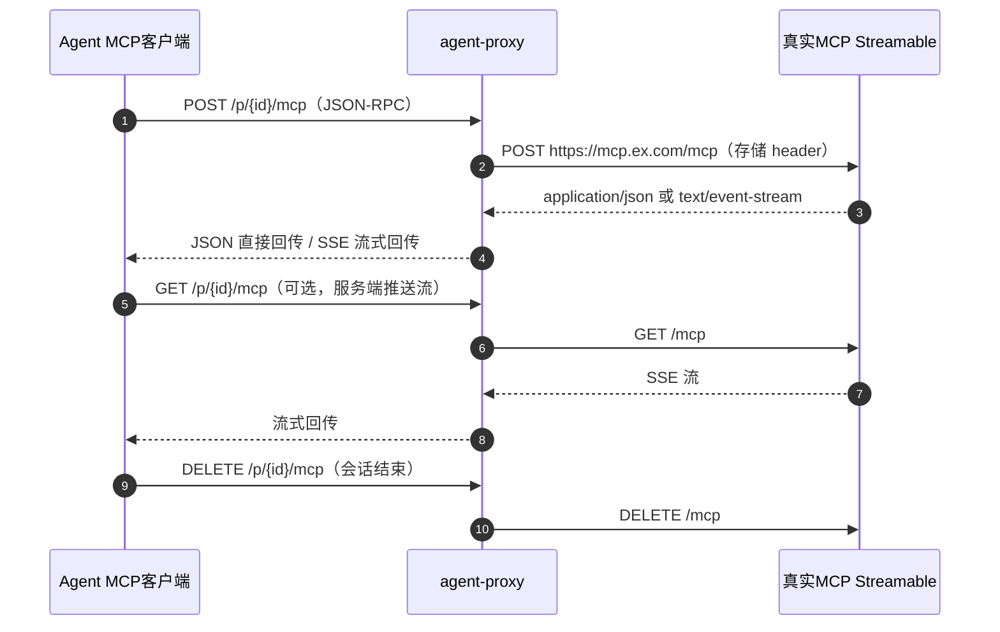
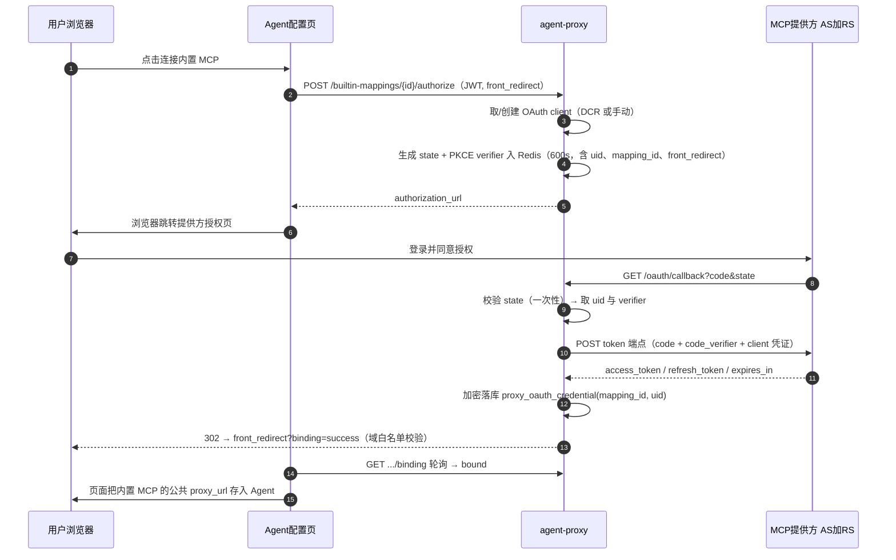
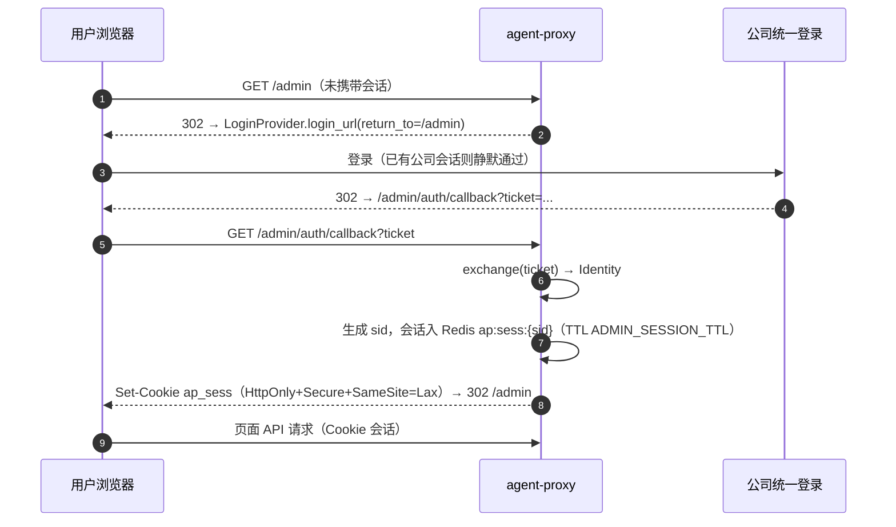

# agent-proxy 首期设计文档（MCP / HTTP 代理）

| | |
|---|---|
| 日期 | 2026-11-21 |
| 状态 | 已评审（设计决策见附录 A） |
| 范围 | 一期：HTTP 前缀代理 + MCP（SSE / Streamable HTTP）代理 + 内置公共映射与 OAuth 凭证托管（M6）+ 管理页面与 Prometheus（M7）；场景矩阵见 1.2 |

---

## 1. 背景与目标

### 1.1 背景

Agent 平台的用户需要接入外部 MCP 服务与 HTTP API。如果让 Agent 直接持有外部真实地址与凭据（API Key 等），会带来：

- **凭据泄露风险**：真实地址、密钥落地在 Agent 配置中，可见可导出；
- **无法统一管控**：平台无法审计、禁用、收回某个外部依赖；
- **凭据与用户绑定缺失**：外部调用无法追溯到平台用户。

因此引入 **agent-proxy**：所有 Agent 对外访问一律经代理转发，真实地址与凭据只存在于代理侧。

### 1.2 代理场景总览（重点）

agent-proxy 的全部能力围绕一张场景矩阵展开，按两个维度划分：

- **归属**：用户级（用户自己填地址和凭据，因人而异）vs 系统级（平台内置，地址固定，管理员一次性创建）；
- **凭据形态**：`static`（静态共享凭据，注册时填写、脱敏存储）vs `oauth`（按用户 OAuth 授权，凭证托管在代理侧）。

| # | 场景 | 类型 | 创建者 | 调用者 | 凭据形态 | 设计章节 |
|---|---|---|---|---|---|---|
| **S1** | **用户级 MCP**（私有） | mcp | 用户 | 仅注册者 | 用户填写的静态 header（脱敏存储，调用时还原） | §8.3 / §8.4 |
| **S2** | **用户级 HTTP API**（私有） | http | 用户 | 仅注册者 | 同上；前缀映射透传 | §8.2 |
| **S3** | **系统级内置 MCP / HTTP**（共享静态凭据） | mcp / http | 管理员 | 任意有效用户 | 管理员配置的共享静态 header，无需绑定 | §14.2 |
| **S4** | **系统级内置 MCP / HTTP**（OAuth 凭证托管） | mcp / http | 管理员 | 任意有效用户（须先完成授权绑定） | 用户个人 OAuth2/2.1 凭证，按用户注入 `Authorization` | §14 |

**典型例子**：

- **S1**：用户接入自己的远程 MCP（如自建 npx 服务），填 `https://my-mcp.ex.com/sse` + 他的 API Key；
- **S2**：用户接入某 HTTP API：注册 `http://bobo.com/api/v1` → 代理 `/p/{id}/orders` → 真实 `http://bobo.com/api/v1/orders`；
- **S3**：公司统一采购的 MCP 服务，全平台共用一个服务级 API Key，内置后所有用户直接可用；
- **S4**：如 GitHub 官方 MCP——必须以**用户个人身份** OAuth 登录才能读取该用户的仓库数据，凭证按用户托管、按用户注入。

**场景选型决策图**：



**其他潜在场景**（团队共享映射、租户/组级凭据、注册审批流、OpenAPI 批量导入、入站回调代理等）：按需求另行规划，不在一期范围。

### 1.3 一期目标

1. **HTTP 代理**：前缀映射，任意子路径 / query / body / method 流式透传；
2. **MCP 代理**：支持 **SSE** 与 **Streamable HTTP** 两种远程传输，含 endpoint 事件改写；
3. **注册机制**：用户在 Agent 页面保存前，先调代理注册接口保存真实地址 + 真实 header；代理返回代理地址 + 占位符 header，Agent 侧只保存后者；提供 test 接口在保存前验证配置有效性（见 6.6）；
4. **鉴权**：全部接口使用系统 JWT；私有映射**仅注册者本人可调用**；
5. **内置（公共）MCP + OAuth 凭证托管**（M6）：管理员创建固定地址的公共映射，用户经 OAuth2 / OAuth2.1 授权后个人凭证托管在代理侧，调用时按用户注入（见第 14 章）；
6. **Web 管理页面**（M7）：本服务托管，**无注册与登录页面**，认证复用公司统一登录（登录后跳转回本服务，见 15.1）；
7. **Prometheus 指标监控**：`/metrics` 端点与核心指标（见 15.2）。

### 1.4 非目标（一期不做）

- MCP stdio 传输（本服务只做远程传输代理）；
- 限流、配额；
- 可配置的任意「用户信息 → header」注入映射（一期仅还原注册者存储的 header；第 14 章 OAuth 场景按用户注入 `Authorization` 是唯一例外）；
- MCP 客户端自带 OAuth 直连代理的透传模式（M6 采用代理托管凭证模式，此为另一形态，二期再议）；
- 多实例缓存失效广播（Redis pub/sub）；
- 响应缓存（上游多为动态授权数据，缓存语义风险高）；
- 请求 / 响应内容改写（违背「载荷不解析」原则，见 8.5）；
- gRPC 上游（HTTP/2 语义超出 httpx 代理模型）。

> 注：「Web 管理界面」「Prometheus 指标监控」原列于非目标，现按需求纳入一期（目标 6 / 7）。

---

## 2. 术语与核心概念

| 术语 | 含义 |
|---|---|
| **映射（Mapping）** | 一条注册记录：`mapping_id → 归属用户 + 真实上游地址 + 真实 header`，代理转发的依据 |
| **mapping_id** | 注册时生成的随机 base62 串（12 位，约 71 bit 熵），是路由前缀，不含任何真实地址信息 |
| **代理地址（proxy_url）** | Agent 实际保存和调用的地址，形如 `{EXTERNAL_BASE}/p/{mapping_id}/...` |
| **占位符** | 返回给 Agent 的 header 值，格式 `${PX:<header名>}`，仅起脱敏展示作用 |
| **上游（upstream）** | 真实的 MCP 服务或 HTTP API |

---

## 3. 总体架构



要点：

- 真实地址与真实 header **只存在于 proxy 侧**（MySQL + Redis），Agent 侧只有代理地址与占位符；
- 代理进程**无会话状态**：SSE 会话状态由上游 MCP 自持（session_id 在 URL / header 中回传），代理可水平扩展；
- 流式全程不缓冲：响应体、SSE 事件增量转发；
- 身份校验依赖第三方 token 校验服务（`TokenVerifier` 抽象，`stub` 实现可脱离该依赖开发调试）；
- 公司统一登录仅负责认证入口，本服务**无注册与登录页面**（见 15.1）。

---

## 4. 配置流程（注册）



**回显**：用户再次打开配置页查看/编辑时，页面用存储的代理地址调 `GET /api/v1/mappings/resolve`（见 6.4）取回真实地址与真实 header 显示；编辑保存走 PUT。

**示例（MCP）**

```
POST /api/v1/mappings
{
  "type": "mcp",
  "upstream_url": "https://mcp.ex.com/sse",
  "headers": { "Authorization": "Bearer sk-abc123", "X-User-Id": "u888" }
}

HTTP 201
{
  "mapping_id": "aB3xK9mQ2wR4",
  "proxy_url": "https://agent-prox.com/p/aB3xK9mQ2wR4/sse",
  "headers": { "Authorization": "${PX:Authorization}", "X-User-Id": "${PX:X-User-Id}" }
}
```

**示例（HTTP 前缀）**

```
POST /api/v1/mappings
{ "type": "http", "upstream_url": "http://bobo.com/api/v1", "headers": {} }

HTTP 201
{ "mapping_id": "kL8zN2vQ7wR1", "proxy_url": "https://agent-prox.com/p/kL8zN2vQ7wR1", "headers": {} }

之后: GET /p/kL8zN2vQ7wR1/orders?id=1  →  http://bobo.com/api/v1/orders?id=1
```

---

## 5. 数据模型

### 5.1 MySQL（持久化）

```sql
CREATE TABLE proxy_mapping (
  id               BIGINT UNSIGNED AUTO_INCREMENT PRIMARY KEY,
  mapping_id       VARCHAR(16)  NOT NULL COMMENT '对外路由标识，随机 base62',
  owner_uid        VARCHAR(64)  NOT NULL COMMENT '注册者 uid，来自第三方解码的 Identity.user_id',
  name             VARCHAR(128) NULL COMMENT '显示名（公共映射由管理员填写）',
  type             ENUM('http','mcp') NOT NULL,
  visibility       ENUM('private','public') NOT NULL DEFAULT 'private' COMMENT 'private 仅注册者可调；public 内置映射，任意有效用户可调（见第14章）',
  auth_mode        ENUM('static','oauth') NOT NULL DEFAULT 'static' COMMENT 'static 共享静态凭据；oauth 按用户绑定注入（仅 public，见第14章）',
  upstream_url     VARCHAR(2048) NOT NULL COMMENT 'http: 前缀URL；mcp: 端点URL',
  upstream_headers JSON         NOT NULL COMMENT '真实 header，可选应用层加密',
  test_request     JSON         NULL COMMENT 'http 类型严格验证请求 {method,path,expect_status}，见 6.6',
  status           ENUM('active','disabled') NOT NULL DEFAULT 'active',
  created_at       DATETIME     NOT NULL DEFAULT CURRENT_TIMESTAMP,
  updated_at       DATETIME     NOT NULL DEFAULT CURRENT_TIMESTAMP ON UPDATE CURRENT_TIMESTAMP,
  UNIQUE KEY uk_mapping_id (mapping_id),
  KEY idx_owner_uid (owner_uid),
  KEY idx_visibility (visibility)
) ENGINE=InnoDB DEFAULT CHARSET=utf8mb4 COMMENT='代理映射表';
```

说明：

- `mapping_id` 由 `secrets` 模块生成（base62，12 位），冲突时重试；
- `upstream_headers` 存真实 header 键值对；当 `ENCRYPT_AT_REST=on` 时整体 AES-GCM（Fernet）加密后存入（密钥经环境变量 `MASTER_KEY` 注入）；
- `auth_mode='oauth'` 仅允许 public 映射；转发时按调用者注入其 OAuth 凭证（见 14.5）；
- `test_request` 供 test 接口对 http 映射做严格验证（见 6.6）；
- 内置列表按 `visibility` 过滤（`idx_visibility`）。

### 5.2 Redis（缓存，cache-aside）

| 项 | 设计 |
|---|---|
| key | `ap:mapping:{mapping_id}` |
| value | 映射记录 JSON（含 id、owner_uid、type、upstream_url、upstream_headers、status） |
| TTL | 300 秒 |
| 读 | GET → 命中直接返回；未命中查 MySQL → `SETEX` 回填 |
| 写 | MySQL 落库成功后 `DEL` 缓存 key |
| 降级 | Redis 连接异常时直接回源 MySQL，记 WARN 日志，不影响可用性 |

**一致性**：写时删缓存 + TTL 兜底。多实例部署时，其他实例最多在 TTL 周期内读到旧值；二期可加 Redis pub/sub 失效广播。

### 5.3 OAuth（M6，内置映射专用）

```sql
CREATE TABLE proxy_oauth_client (
  id             BIGINT UNSIGNED AUTO_INCREMENT PRIMARY KEY,
  mapping_id     VARCHAR(16)  NOT NULL COMMENT '关联的公共映射',
  client_id      VARCHAR(256) NOT NULL,
  client_secret  TEXT         NULL COMMENT '加密存储；公共客户端可空',
  token_auth     ENUM('client_secret_basic','client_secret_post','none') NOT NULL DEFAULT 'client_secret_post',
  authorize_url  VARCHAR(2048) NULL COMMENT '手动模式填写；DCR 模式留空',
  token_url      VARCHAR(2048) NULL COMMENT '手动模式填写；DCR 模式留空',
  scopes         VARCHAR(512) NULL,
  source         ENUM('dcr','manual') NOT NULL,
  created_at     DATETIME NOT NULL DEFAULT CURRENT_TIMESTAMP,
  updated_at     DATETIME NOT NULL DEFAULT CURRENT_TIMESTAMP ON UPDATE CURRENT_TIMESTAMP,
  UNIQUE KEY uk_mapping (mapping_id)
) ENGINE=InnoDB DEFAULT CHARSET=utf8mb4 COMMENT='公共映射的 OAuth 客户端注册信息';

CREATE TABLE proxy_oauth_credential (
  id            BIGINT UNSIGNED AUTO_INCREMENT PRIMARY KEY,
  mapping_id    VARCHAR(16) NOT NULL,
  uid           VARCHAR(64) NOT NULL,
  access_token  TEXT NOT NULL COMMENT '强制加密存储（MASTER_KEY）',
  refresh_token TEXT NULL COMMENT '加密存储',
  expires_at    DATETIME NULL,
  scope         VARCHAR(512) NULL,
  status        ENUM('active','invalid') NOT NULL DEFAULT 'active',
  created_at    DATETIME NOT NULL DEFAULT CURRENT_TIMESTAMP,
  updated_at    DATETIME NOT NULL DEFAULT CURRENT_TIMESTAMP ON UPDATE CURRENT_TIMESTAMP,
  UNIQUE KEY uk_mapping_uid (mapping_id, uid),
  KEY idx_uid (uid)
) ENGINE=InnoDB DEFAULT CHARSET=utf8mb4 COMMENT='用户对公共映射的 OAuth 凭证（每用户一份）';
```

**Redis 扩展（M6）**

| key | 用途 | TTL |
|---|---|---|
| `ap:oauth:state:{state}` | 授权流程 state（uid、mapping_id、code_verifier、front_redirect），一次性 | 600s |
| `ap:lock:refresh:{mapping_id}:{uid}` | 凭证刷新互斥锁 | 30s |
| `ap:cred:{mapping_id}:{uid}` | 凭证缓存（绑定 / 解绑 / 刷新时失效） | 60s |

---

## 6. API 设计

### 6.1 管理接口（前缀 `/api/v1/mappings`，全部要求系统 JWT）

| 方法 | 路径 | 说明 |
|---|---|---|
| POST | `/api/v1/mappings` | 注册映射，返回代理地址 + 占位符 header |
| POST | `/api/v1/mappings/{mapping_id}/test` | 测试个人映射有效性（见 6.6） |
| GET | `/api/v1/mappings` | 当前用户的映射列表（分页） |
| GET | `/api/v1/mappings/{mapping_id}` | 映射详情，**真实值仅注册者可见**（响应体同 6.4） |
| GET | `/api/v1/mappings/resolve` | **回显接口**：按代理地址查询参数回查真实地址与真实 header，见 6.4；静态路由须先于 `{mapping_id}` 动态路由注册 |
| PUT | `/api/v1/mappings/{mapping_id}` | 更新 upstream_url / headers / status，成功后删缓存 |
| DELETE | `/api/v1/mappings/{mapping_id}` | 删除映射，成功后删缓存 |

**注册参数校验规则**

| 字段 | 规则 |
|---|---|
| `type` | 必填，`http` 或 `mcp` |
| `name` | 可选，显示名（公共映射建议填写） |
| `visibility` | 可选，`private`（默认）或 `public`；**public 仅管理员（`Identity.role` == `ADMIN_ROLE`，默认 `admin`）可设置** |
| `upstream_url` | 必填；scheme 仅 http/https；host 必填；mcp 类型建议为完整端点（如 `.../sse`、`.../mcp`） |
| `test_request` | 可选（仅 http 类型）；`{method, path, expect_status}`，供 test 接口做严格验证（见 6.6） |
| `headers` | 可选 object；键名须为合法 header 名（RFC 7230 token）；值必须为字符串；数量 ≤ 32，单值长度 ≤ 4KB |

**响应码**：201 成功；400 参数非法；401 JWT 无效。非注册者操作他人映射 → 404（不暴露存在性）。

**响应体约定**

- **POST / PUT**：均返回 `{mapping_id, proxy_url, headers占位符}`——PUT 更新 `upstream_url` 时 proxy_url 的路径部分可能变化（如 `/sse`→`/mcp`），页面必须以响应中的新代理配置**重新保存到 Agent**；
- **GET 列表**：`[{mapping_id, name, type, upstream_url, proxy_url, status, created_at, updated_at}]`，**不含真实 headers**（真实值仅详情 / resolve 返回）；
- **DELETE**：删除后 Agent 侧残留的代理地址立即 404，页面应同步清理已保存的代理配置；
- 同一用户重复注册相同 `upstream_url` 允许并存（不同 header 场景），不做 upsert。

### 6.2 代理端点

```
ANY /p/{mapping_id}/{path}          # path 可为空；query 透传
GET /healthz                        # 存活检查（无鉴权，不记审计）
GET /readyz                         # 就绪检查：MySQL / Redis 可达（供 LB 摘流）
GET /metrics                        # Prometheus 指标（见 15.2）
GET /admin/*                        # 管理页面（本服务托管，见 15.1）
```

**代理地址（proxy_url）拼装规则**

```
proxy_url = {EXTERNAL_BASE}/p/{mapping_id} [ + upstream_path ]    # mcp 类型附加端点路径，如 /sse
```

`EXTERNAL_BASE` 为配置项（网关后的对外域名），保证返回的代理地址可直接使用。

### 6.3 占位符规范

- 格式：`${PX:<header名>}`，如 `${PX:Authorization}`；
- 生成：注册响应中，对每个真实 header 的 value 生成同名占位符（**同 key 不同值**）；
- 还原：转发时**按 key 从存储直接取真实值**重建出站 header，占位符内容不参与任何解析；
- Agent 即使把占位 header 原样发回，代理也一律丢弃（见 8.1），不构成泄露或伪造通道。

### 6.4 回显接口（查看/编辑已保存配置）

**场景**：Agent 页面保存的是代理地址 + 占位符 header；用户之后重新打开配置页查看或编辑时，页面需要按手里的代理地址取回**真实地址与真实 header** 用于显示。

```
GET /api/v1/mappings/resolve?proxy_url=https%3A%2F%2Fagent-prox.com%2Fp%2FaB3xK9mQ2wR4%2Fsse
（Authorization: Bearer <注册者JWT>）

HTTP 200
{
  "mapping_id": "aB3xK9mQ2wR4",
  "name": null,
  "type": "mcp",
  "upstream_url": "https://mcp.ex.com/sse",          ← 真实地址
  "headers": { "Authorization": "Bearer sk-abc123",  ← 真实 header
               "X-User-Id": "u888" },
  "proxy_url": "https://agent-prox.com/p/aB3xK9mQ2wR4/sse",
  "status": "active",
  "created_at": "2026-11-21T10:00:00",
  "updated_at": "2026-11-21T10:00:00"
}
```

规则：

1. **鉴权**：必须系统 JWT，且 uid = owner_uid；非注册者一律 404（隐藏存在性），与其他管理接口一致；
2. **参数解析**：`proxy_url` 为 URL 编码后的代理地址，服务端解析 `/p/{mapping_id}` 段定位映射；也接受直接传 12 位 mapping_id；无法解析为本服务代理地址 → 400 `INVALID_PARAM`；
3. **加载**：与详情/转发共用 cache-aside 加载逻辑（Redis → MySQL 回填）；
4. **审计**：详情（`GET /{mapping_id}`）与 resolve 两个接口都会输出真实 header，是管理域中仅有的两个；每次调用均记审计日志（`action=view_credentials`）；
5. 用户编辑后保存走 PUT 更新接口，更新成功后删缓存。

### 6.5 内置 MCP（公共映射）与 OAuth 接口（M6，详见第 14 章）

| 方法 | 路径 | 鉴权 | 说明 |
|---|---|---|---|
| GET | `/api/v1/builtin-mappings` | JWT | 内置映射列表：name、type、proxy_url、**占位符 headers**、auth_mode、我的绑定状态（页面据此保存完整代理配置） |
| POST | `/api/v1/builtin-mappings/{mapping_id}/authorize` | JWT | 发起授权：入参 `front_redirect`（回跳页面，域白名单校验），返回 `{authorization_url}` |
| GET | `/oauth/callback` | 无（state 关联用户） | OAuth 回调：code 换 token、加密落库、302 回跳平台页面 |
| GET | `/api/v1/builtin-mappings/{mapping_id}/binding` | JWT | 查询我的绑定状态（页面轮询） |
| DELETE | `/api/v1/builtin-mappings/{mapping_id}/binding` | JWT | 解绑：删除本地凭证（提供方支持时同时调用 revoke 吊销） |
| POST | `/api/v1/builtin-mappings/{mapping_id}/test` | admin 或已绑定用户 | 测试公共映射：admin 测静态配置；已绑定用户测本人 OAuth 凭证真实有效（见 6.6） |

### 6.6 配置有效性测试（test 接口，随 M2–M4 交付）

**目的**：配置保存到 Agent 前验证「地址可达 + 凭据有效」；个人映射与公共映射（内置 MCP）都需要，形成配置闭环。

**验证逻辑**——复用第 8 章转发管线（出站 header 重建、URL 还原与真实调用完全一致），测的即真实路径：

| 类型 | 验证方式 | 通过标准 |
|---|---|---|
| mcp + Streamable | 向端点发标准 `initialize` JSON-RPC | 拿到含 `serverInfo` 的响应（硬性判定） |
| mcp + SSE | GET 注册端点读流 | 收到 `text/event-stream` + 首个 `endpoint` 事件后立即断开 |
| http（默认） | `GET upstream_url` | 能拿到任意 HTTP 响应即「可达」，状态码作为参考信息（base 前缀 URL 可能天然 404，不硬判失败） |
| http（严格，可选） | 注册参数 `test_request`（method / path / expect_status） | 实际状态码 == expect_status |
| OAuth 绑定用户 | 以本人凭证执行对应 mcp 验证 | 同 mcp 规则；凭证失效提示重新授权 |

**返回**：`{ok, status_code, latency_ms, detail}`；测试专用短超时 5s；上游失败反映为 `ok=false` + `detail` 说明，不产生代理自身的 502/504 错误响应。

**安全边界**：仅能对**已注册映射**发起（不接受任意 URL，防探测滥用）；无凭证用户对 OAuth 型公共映射发起 → `OAUTH_BINDING_REQUIRED`；审计记 `action=test_mapping`，不含 header 值。

---

## 7. 鉴权设计（系统 JWT，第三方校验 + 抽象对接）

**原则**：JWT 的**校验与解码由第三方接口提供**，代理本地不做验签与密钥管理；代理通过 `TokenVerifier` 抽象接口对接，具体实现后续接入。业务代码（管理接口、代理端点）只依赖 `Identity`，不感知校验细节。

### 7.1 身份模型与抽象接口

```python
@dataclass(frozen=True)
class Identity:
    user_id: str            # 必须，全局唯一；即映射归属 owner_uid 的来源（下文 uid ≡ user_id）
    user_name: str | None   # 显示名，仅用于审计
    role: str | None        # 角色；== ADMIN_ROLE（默认 "admin"）时为管理员（见 14.2）

class TokenVerifier(Protocol):
    async def verify(self, token: str) -> Identity:
        """校验并解码 token；明确无效（无效/过期/格式错）抛 TokenInvalidError → 401；
        依赖的第三方服务不可用（超时/连接失败）抛 TokenServiceError → 503"""
```

- `auth.get_current_identity`：FastAPI 依赖，仅依赖 `TokenVerifier`；
- 实现一 `stub`（默认，开发/测试）：本地解码不验签，便于联调与集成测试；**仅限开发/测试，`ENV=prod` 时拒绝以 stub 启动**；
- 实现二 `third_party`（后续实现）：对接第三方校验接口（接口协议、地址等参数在实现时确定，注册为独立 verifier 类，不影响任何业务代码）。

| 项 | 设计 |
|---|---|
| 携带方式 | `Authorization: Bearer <token>` |
| 代理侧用途 | ① 管理接口：user_id 归属校验；② 代理端点：user_id = `owner_uid` 才放行（public 映射任意有效身份可调） |
| token 生命周期 | 校验、刷新、下发均在第三方侧，代理不参与 |
| **不透传** | **调用者的 token 绝不转发给上游**（见 8.1） |

错误：token 缺失 / 无效 / 过期 → `401`；user_id ≠ owner_uid → `403`；第三方校验服务不可用 → `503 AUTH_SERVICE_UNAVAILABLE`。

---

## 8. 转发设计

### 8.1 通用规则

1. **出站 header 重建**（安全核心）：出站请求 header = **存储的 upstream_headers 全量** + 协议必要 header（`Accept`、`Content-Type`、`Content-Length`、`Content-Encoding`（gzip 等请求体透传必需），MCP 的 `Mcp-Session-Id` / `Last-Event-ID` / `MCP-Protocol-Version` 白名单透传）。调用方请求中的其余 header（含其 JWT、占位 header）**一律不透传**；hop-by-hop header（`Connection`、`Keep-Alive`、`Transfer-Encoding`、`TE`、`Trailer`、`Proxy-*`、`Upgrade`）排除。
2. **流式**：请求 body 与响应 body 均以异步流转发（httpx stream），不落盘、不整体驻留内存；响应不限大小，请求体默认上限 10MB（可配），流式读取按字节计数、超限立即断开并返回 413。**响应体不解析、不改写**（已知限制见 9.10）。
3. **响应 header 过滤**：剥离 hop-by-hop 后原样回传（`Content-Type` 等），绝不含存储的真实 header；`Location` 头处理见第 7 条。
4. **客户端断开**：立即取消上游流并释放连接。
5. **超时**（可配）：

| 场景 | connect | read |
|---|---|---|
| 普通 HTTP 转发 | 10s | 60s |
| SSE 长连接 | 10s | 不设（依赖心跳保活） |
| Streamable 流式响应 | 10s | 不设 |

6. **重试**：一期不自动重试（避免非幂等请求重复触发）。
7. **重定向**（防真实地址泄露）：**同源**（注册上游 origin 内）重定向由代理**内部跟随**（默认 ≤3 跳，`UPSTREAM_MAX_REDIRECTS`），存储 header 每跳重放，方法语义按 HTTP 规范（303→GET，307/308 保方法）；**跨源**重定向不跟随，响应原样透传（`Location` 指向第三方属上游自身行为）。同源 `Location` 永不回传给 Agent。
8. **路径安全**：`/p/{id}` 子路径拒绝 `.` / `..` 段及 URL 编码变体（`%2e` 等）→ 400，防止拼接后逃逸注册前缀；其余子路径按原文拼接，不做规范化。
9. **缓冲与网关**：SSE / 流式响应使用 `StreamingResponse` 并发送 `X-Accel-Buffering: no`；前置 nginx 等网关需 `proxy_buffering off`，且网关读超时必须大于上游心跳间隔，否则长连接会被网关切断。
10. **上游 TLS**：证书默认强校验，不提供跳过校验的开关。
11. **连接池与并发保护**：全局共享单个 httpx `AsyncClient`（连接复用，lifespan 内创建 / 关闭）；连接池上限 `UPSTREAM_MAX_CONNECTIONS`（默认 200），超限立即返回 503 `PROXY_BUSY`——一期不限流，但必须有资源上限，防止异常上游拖垮进程。
12. **优雅停机**：SIGTERM 后停止接收新请求，在途请求与 SSE 流排空（`SHUTDOWN_DRAIN_SECONDS` 默认 10s，超时强断）；SSE 客户端按协议自动重连（携带 `Last-Event-ID`，已在白名单透传）。

### 8.2 HTTP 前缀映射

```
转发URL = upstream_url(规范化去尾斜杠) + "/" + 子路径 + "?" + query
```



### 8.3 MCP — SSE 传输

关键点：SSE `endpoint` 事件改写 + 后续 POST 按上游 **origin 根**还原路径。

**路径分发规则（mcp 类型）**

| 请求路径 | 转发目标 |
|---|---|
| `/p/{id}` + 注册端点路径（如 `sse`） | 完整注册 upstream_url（初始连接） |
| `/p/{id}` + 其他任意路径 | **上游 origin 根** + 该路径（messages 端点等） |

**endpoint 事件改写规则**：增量解析 SSE 流；遇到 `event: endpoint` 的 `data:` 行——若值为绝对 URL 或路径，取其 path + query，改写为 `data: /p/{id}<path>?<query>` 下发；其余事件字节级原样透传。



限制说明：仅支持根相对路径形式的 endpoint 事件（官方 Python / TypeScript SDK 均为此形式）；客户端断开即取消上游连接。代理不保存会话状态，session_id 由上游通过 URL 自持。

**SSE 改写实现要点**：以增量**行解析器**实现——按行读取上游流（保留原始行尾 `\r\n` / `\n`），跟踪当前 `event:` 名；当事件名为 `endpoint` 时改写其 `data:` 行，其余行（含 `message` 事件、`retry:` 行、`:` 心跳注释行）字节级原样透传，每行读取后立即 flush，不做整体缓冲。

### 8.4 MCP — Streamable HTTP

单一端点，无需改写：



`Mcp-Session-Id` 经白名单透传，会话状态由上游自持。

### 8.5 两类代理的统一与差异

**统一的部分（一套机制）**：

| 维度 | 说明 |
|---|---|
| 入口 | 同一路由 `ANY /p/{mapping_id}/{path}` |
| 注册 | 同一接口 `POST /api/v1/mappings`，仅 `type` 字段区分 `http` / `mcp` |
| 存储 / 缓存 | 同一 `proxy_mapping` 表 + Redis cache-aside |
| 鉴权 | 同一 JWT 校验 + 仅注册者可调 |
| header 策略 | 同一出站 header 重建（存储还原、调用方 header 不透传） |
| 转发骨架 | 同一「还原 URL → 流式转发 → 过滤回传」管线，均**不解析业务载荷** |

**差异的部分（仅传输适配层）**：

| | http | mcp |
|---|---|---|
| URL 还原 | 纯前缀拼接：`upstream_url + /子路径 + query`，任意深度 | 注册端点路径直达（初始连接）；其余路径按上游 **origin 根**还原（messages 等） |
| 解析流内容 | 否 | 仅 SSE 需拦截改写 `endpoint` 事件；SSE 其余事件与 Streamable 全部字节级原样透传 |

**MCP 载荷透明性**：代理不解析、不校验、不改动任何 JSON-RPC 载荷。`initialize`、`tools/list`、`tools/call`、`resources/*`、`prompts/*`、`notifications/*`、`ping` 等全部协议操作，以及响应流（SSE `message` 事件、Streamable 的 JSON / SSE 响应）均原样透传——MCP 功能完整性不受代理影响。代理唯一的介入点是 SSE 握手的 `endpoint` 事件地址改写（见 8.3），目的是让后续消息回到代理。

---

## 9. 安全设计

| # | 措施 | 说明 |
|---|---|---|
| 1 | JWT 鉴权 | 管理与代理端点全覆盖；仅注册者可调用（403） |
| 2 | 防凭据泄露 | `/p/*` 响应永不回显真实 header；出站 header 从存储重建；真实值仅注册者经管理域可见（详情 / resolve 回显，见 6.4，访问入审计日志） |
| 3 | SSRF 防护 | 注册时校验 scheme（仅 http/https）；解析域名并拒绝私网 / 环回 / 链路本地地址段（`10/8`、`172.16/12`、`192.168/16`、`127/8`、`169.254/16`、`::1` 等）；可用 `SSRF_ALLOW_PRIVATE=true` 放开（内联调环境） |
| 4 | 参数加固 | header 键名合法性校验、数量与长度上限、请求体大小上限（流式按字节计数，超限断开返回 413）；代理子路径拒绝 `.` / `..` 段（含 URL 编码变体），防止逃逸注册前缀（见 8.1 第 8 条） |
| 5 | 审计日志 | 记录 user_id、user_name、mapping_id、request_id、method、path、status、耗时、上下行字节数、client_ip；**不含任何 header 值** |
| 6 | 落库加密 | `ENCRYPT_AT_REST=on` 时 upstream_headers 以 AES-GCM 加密存储（`MASTER_KEY` 环境变量；开启时列以 TEXT 存密文） |
| 7 | TLS | 由网关 / 负载均衡终结，代理服务部署在内网；上游侧 TLS 证书强校验（8.1 第 10 条） |
| 8 | CORS | 管理接口供浏览器配置页直连时需跨域：`CORS_ALLOWED_ORIGINS` 配置平台页面域名白名单（仅管理域开启）；`/p/*` 默认不开 CORS（Agent 运行时为服务端直连，如需浏览器直连再单独开启） |
| 9 | 重定向 | 同源重定向内部跟随、`Location` 永不回传；跨源原样透传（见 8.1 第 7 条） |
| 10 | 已知限制（一期接受） | ① HTTP 响应体不解析不改写：上游响应体中若含真实地址绝对链接（如分页 `next`）会原样到达 Agent——**凭据（header）不受影响**，建议上游返回相对路径；MCP JSON-RPC 载荷不含 URL，不受影响。② DNS rebinding（注册时校验、请求时重新解析）一期不做强防护。③ SSE 半开连接（客户端异常消失）依赖 TCP keepalive 检测，一期不设最长连接时长 |
| 11 | OAuth 凭证（M6） | PKCE(S256) 必须；state 一次性 + 600s TTL + 绑定 uid；redirect_uri 精确等于 `{EXTERNAL_BASE}/oauth/callback/{mapping_id}`；access/refresh token 强制加密落库；回跳页仅允许 `CORS_ALLOWED_ORIGINS` 域（防开放重定向）；token 与 client_secret 不入任何日志，绑定/解绑/刷新入审计日志 |

---

## 10. 错误处理

统一错误体：`{"code": "<CODE>", "message": "<人类可读描述>", "request_id": "<本次请求ID>"}`

| 场景 | HTTP | code |
|---|---|---|
| JWT 缺失 / 无效 / 过期 | 401 | `INVALID_TOKEN` |
| 非注册者调用 / 操作；非管理员创建/改删公共映射 | 403（代理端点与越权）/ 404（管理接口，隐藏存在性） | `FORBIDDEN` / `MAPPING_NOT_FOUND` |
| 映射不存在或已禁用 | 404 | `MAPPING_NOT_FOUND` |
| 注册 / 更新参数非法 | 400 | `INVALID_PARAM` |
| 代理子路径含 `..` 等非法段 | 400 | `INVALID_PARAM` |
| 用户未完成 OAuth 绑定 / 凭证失效 | 401 | `OAUTH_BINDING_REQUIRED`（body 附授权引导信息） |
| 第三方 token 校验服务不可用 | 503 | `AUTH_SERVICE_UNAVAILABLE` |
| 上游连接失败 | 502 | `UPSTREAM_ERROR` |
| 上游超时 | 504 | `UPSTREAM_TIMEOUT` |
| 请求体超限 | 413 | `BODY_TOO_LARGE` |
| 代理并发 / 连接池超限 | 503 | `PROXY_BUSY` |
| 上游 4xx / 5xx | 原样透传状态码与响应体 | — |

上游错误响应**原样透传**给 Agent（保留状态码），代理仅在自身故障时产生 502/504。

**流式传输中的错误**：一旦响应流开始（如 SSE 已下发首字节），上游中途断开时代理只能终止流（客户端表现为连接提前关闭）并记录日志，无法再回传结构化错误体；流开始**前**的错误（连接失败、超时、鉴权失败）仍返回标准错误体。

---

## 11. 日志设计（运行 / 审计 / 追踪三层）

遵循全局滚动规范（按天 + 单文件 50MB 立即滚动 + 保留 7 天 + 同一文件全局仅一个滚动 handler，后缀精确到秒防同日覆盖）：

| 文件 | 用途 | 内容 |
|---|---|---|
| `logs/agent-proxy.log` | 运行日志 | 启动 / 配置 / 缓存 / 连接池 / 异常等系统事件 |
| `logs/audit.log` | 审计日志 | JSON 行，每次调用的元数据（9.5 字段），**不含 header 值与 body** |
| `logs/trace.log` | **追踪日志**（排障核心） | 请求 / 响应明细，粒度由 `TRACE_MODE` 控制 |
| （关联键） | `request_id` | 每请求 UUID，贯穿三层日志，并随错误体与 `X-Request-ID` 响应头返回 |

### 11.1 追踪日志（trace.log）——请求与响应的可回放记录

**粒度模式（`TRACE_MODE`）**：

| 模式 | 内容 | 适用 |
|---|---|---|
| `off` | 不记录 | 高流量生产稳态 |
| `metadata`（默认） | 请求行、还原后上游 URL、header 名 + **值指纹**、body 字节数、响应状态、耗时 | 常态运行 |
| `body` | metadata + 请求 / 响应 body 全文（截断） | 排障期临时开启（改环境变量重启生效） |

**格式（JSON 行，同 request_id 可完整回放一次调用）**：

```json
{"ts":"2026-11-21T10:00:00.123+08:00","request_id":"9f8e7d","uid":"u999","mapping_id":"aB3xK9mQ2wR4","phase":"request","method":"POST","url":"https://bobo.com/api/v1/orders","headers":{"X-API-Key":"sk-a****-key(len=13)","Content-Type":"application/json"},"body_bytes":212}
{"ts":"...","request_id":"9f8e7d","phase":"response","status":200,"duration_ms":123,"body":"{\"orders\":[...]}","body_truncated":false}
{"ts":"...","request_id":"...","phase":"sse_event","event":"message","data":"{\"jsonrpc\":\"2.0\",...}","data_truncated":false}
```

**脱敏规则（安全底线，任何模式都生效）**：

- 真实凭据（存储 header 值、调用方 token、OAuth token / client_secret）：**值以指纹呈现** `前4****后4(len=N)`——足以比对「发出的凭据与配置是否一致」（典型如 401 排障），不泄露完整密钥；**短值规则**：长度 ≥12 才显示前4后4，否则只记 `****(len=N)`（防 8–11 字符短密钥被前后缀拼出全值）；
- 打码范围：精确集合（authorization / proxy-authorization / cookie / set-cookie / x-auth-token / x-api-key / api-key）+ 子串兜底——header 名含 `token` / `secret` / `key` / `auth` / `cookie` 之一一律打码（未列出的敏感头默认安全）；
- 占位 header 显示为 `${PX:<名>}`（本就无敏感内容）；上游响应的 `Authorization` 等敏感头同样打码。

**body / SSE 处理**：

- 截断上限 `TRACE_BODY_MAX_SIZE`（默认 64KB），超长标记 `"truncated": true`；流式响应只截前 N 字节（大文件不落盘）；
- SSE（body 模式）：记录连接建立、`endpoint` 事件（**改写前 + 改写后**）、每个 `message` 事件（截断）、关闭原因；心跳注释行与 `retry:` 不记录；
- 二进制 body（非文本 Content-Type）只记字节数，不记内容。

**性能与数据敏感性**：trace 写入经 `QueueHandler` + 后台线程异步落盘，不阻塞事件循环；body 模式磁盘消耗高，排障结束切回 `metadata`；body 含用户业务数据，需与公司日志系统访问权限策略对齐，7 天后随滚动自动清理。

---

## 12. 技术栈与项目结构

| 项 | 选择 |
|---|---|
| 语言 / 运行时 | Python 3.12（`D:\Python312\python.exe -m venv .venv`，依赖只装 venv） |
| Web 框架 | FastAPI + uvicorn（异步） |
| 上游调用 | httpx（异步、流式） |
| ORM / 驱动 | SQLAlchemy 2（async）+ aiomysql |
| 缓存 | redis-py（async） |
| JWT | PyJWT |
| 落库加密 | cryptography（Fernet，可选） |
| 指标 | prometheus-client（`/metrics`） |
| 部署 | Docker Compose（自包含栈：app + 可选 MySQL/Redis；外部已有实例通过 MYSQL_DSN / REDIS_URL 指向即可） |
| 管理页面 | FastAPI + Jinja2 模板 + 原生 JS（fetch），无前端构建链 |
| 测试 | pytest + pytest-asyncio |

分层：`api`（接口层）→ `services`（应用服务：映射 CRUD / cache-aside 加载 / 归属校验，管理、回显、转发共用）→ `forward` / `oauth`（转发与领域能力）→ `db` / `cache` / `auth`（基础设施与横切）。

```
agent-proxy/
├── docs/superpowers/specs/          # 设计文档
├── src/agent_proxy/
│   ├── main.py                      # FastAPI 组装、生命周期（AsyncClient、优雅停机）
│   ├── config.py                    # 环境配置
│   ├── auth.py                      # Identity / TokenVerifier 抽象 + stub 实现（第三方实现后续接入）
│   ├── services.py                  # 应用服务层：映射 CRUD、cache-aside 加载、归属/管理员校验
│   ├── db.py                        # MySQL engine / session
│   ├── cache.py                     # Redis cache-aside
│   ├── models.py                    # ORM: ProxyMapping / OAuthClient / OAuthCredential
│   ├── schemas.py                   # Pydantic 请求/响应模型
│   ├── placeholder.py               # 占位符化 / 还原
│   ├── mapping_id.py                # 随机 ID 生成
│   ├── ssrf.py                      # 上游地址校验
│   ├── headers.py                   # 出站 header 重建 / hop-by-hop 过滤
│   ├── logging_setup.py             # 滚动日志（全局规范）
│   ├── trace.py                     # 追踪日志：三档粒度、header 指纹脱敏、body 截断、SSE 事件记录
│   ├── metrics.py                   # Prometheus 指标定义与中间件埋点
│   ├── api/
│   │   ├── mgmt.py                  # /api/v1/mappings 管理接口
│   │   ├── builtin.py               # 内置 MCP（公共映射）接口 + OAuth 回调（M6）
│   │   ├── proxy.py                 # /p/{mapping_id}/{path} 转发入口
│   │   └── admin_pages.py           # 管理页面路由 + SSO 回调 + 会话（M7）
│   ├── oauth/
│   │   ├── client.py                # DCR / 手动客户端注册（M6）
│   │   └── credential.py            # 凭证存取、刷新锁、注入（M6）
│   ├── sso/
│   │   └── login.py                 # LoginProvider 抽象 + stub（公司统一登录后续接入，M7）
│   └── forward/
│       ├── http_forward.py          # HTTP 前缀流式转发
│       ├── mcp_sse.py               # SSE 长连接 + endpoint 改写
│       └── mcp_streamable.py        # Streamable HTTP 透传
├── src/agent_proxy/admin/           # 管理页面模板与静态资源（Jinja2 + JS，M7）
├── tests/
│   ├── unit/                        # 单元测试
│   └── integration/                 # mock 上游全链路
├── pyproject.toml
├── .env.example
└── README.md
```

**配置项（环境变量）**

| 变量 | 说明 | 默认 |
|---|---|---|
| `AGENT_PROXY_LISTEN` | 监听地址 | `0.0.0.0:8800` |
| `EXTERNAL_BASE` | 对外域名，用于拼 proxy_url | 必填 |
| `TOKEN_VERIFY_IMPL` | token 校验实现：`stub`（开发/测试，本地解码不验签）/ `third_party`（第三方接口，参数实现时定） | `stub` |
| `ENV` | 运行环境；`prod` 下禁止 stub 校验实现启动 | `dev` |
| `MYSQL_DSN` | MySQL 连接串 | 必填 |
| `REDIS_URL` | Redis 连接串 | 必填 |
| `CACHE_TTL` | 映射缓存 TTL（秒） | `300` |
| `UPSTREAM_CONNECT_TIMEOUT` / `UPSTREAM_READ_TIMEOUT` | 上游超时（秒） | `10` / `60` |
| `MAX_BODY_SIZE` | 请求体上限 | `10MB` |
| `UPSTREAM_MAX_REDIRECTS` | 同源重定向内部跟随跳数 | `3` |
| `UPSTREAM_MAX_CONNECTIONS` | 上游连接池上限（超限 503 `PROXY_BUSY`） | `200` |
| `SHUTDOWN_DRAIN_SECONDS` | 优雅停机排空在途流的等待时间（秒） | `10` |
| `ADMIN_SESSION_TTL` | 管理页面会话有效期（秒，Redis 存储） | `28800`（8h） |
| `LOGIN_IMPL` | 登录对接实现：`stub`（开发）/ `company_sso`（公司统一登录，参数实现时定） | `stub` |
| `CORS_ALLOWED_ORIGINS` | 管理域跨域白名单（逗号分隔，空=不开） | 空 |
| `SSRF_ALLOW_PRIVATE` | 允许内网上游（联调用） | `false` |
| `OAUTH_STATE_TTL` | 授权 state 有效期（秒） | `600` |
| `ADMIN_ROLE` | 管理员角色值（`Identity.role` 与之相等即为管理员） | `admin` |
| `ENCRYPT_AT_REST` / `MASTER_KEY` | 落库加密 | `false` / 必填(当开启) |
| `LOG_DIR` / `LOG_LEVEL` | 日志目录 / 级别 | `logs` / `INFO` |
| `TRACE_MODE` | 追踪日志粒度：`off` / `metadata`（默认）/ `body` | `metadata` |
| `TRACE_BODY_MAX_SIZE` | body 记录截断上限 | `64KB` |

### 12.1 部署形态（Docker Compose）

**标准交付物**：`Dockerfile` + `docker-compose.yml`（`app` + 可选 `mysql:8.4` / `redis:7` 自包含栈）。

- **开发 / 演示（Windows 本机 Docker Desktop）**：`docker compose up -d`；`EXTERNAL_BASE=http://<本机局域网IP>:8800`；注意 Windows 防火墙放行端口、主机睡眠即服务下线——仅适合开发联调，不适合长期驻留；
- **生产（Linux 服务器 / vm01）**：同一份 compose 直接迁移；vm01 无外网时在本机构建镜像后 `docker save` → 拷贝 → `docker load`（或走内网镜像源）；
- **复用已有实例**：compose 中不启 mysql/redis 服务块，`MYSQL_DSN` / `REDIS_URL` 指向外部地址即可；
- **依赖声明**：`depends_on` + 应用启动时自检 MySQL / Redis 连通（配合 `/readyz`）。

---

## 13. 测试策略

| 层级 | 内容 |
|---|---|
| 单元 | 占位符化/还原、URL 拼接与规范化、路径分发、endpoint 事件改写、TokenVerifier 抽象与 stub 解码（含无效 token 401、stub 生产环境拒绝启动）、SSRF 校验、header 重建与过滤 |
| 集成 | pytest + mock 上游（普通 HTTP echo / SSE / Streamable）走全链路：注册 → 占位符校验 → 调用 → 用 echo 验证转发 URL 与出站 header 与存储一致；权限用例（无 token 401、他人 403、禁用 404）；resolve 回显用例（注册者取回真实值、他人 404、非法 proxy_url 400、直接传 mapping_id）；**安全用例**：子路径 `..` / `%2e%2e` 拒绝 400、同源重定向内部跟随且 `Location` 不回传（307 POST 保方法）、跨源重定向透传、gzip 请求体透传、413 截断、流中断终止、CORS 预检 OPTIONS |
| 真实客户端 | MCP Inspector（`npx @modelcontextprotocol/inspector`）分别以 SSE 与 Streamable 连接代理，完成 tools/list 与 tools/call |
| 缓存 | 命中 / 未命中回源 / 写后失效 / Redis 停机降级 |
| OAuth（M6） | mock AS 全流程：DCR 注册、授权码+PKCE 换 token、state 过期 / 伪造 400、回调落库加密校验、过期自动刷新与并发刷新锁、未绑定调用 401 `OAUTH_BINDING_REQUIRED`、非 admin 创建 public 映射 403、回跳域白名单外拒绝 |
| test 接口 | http 连通 / test_request 严格验证；SSE 首个 endpoint 事件；Streamable initialize 语义验证；OAuth 凭证失效提示重新授权；未注册 URL 拒绝探测 |
| 管理页面 / SSO（M7） | stub 登录 → 回调 → 会话 → 页面操作全流程；Cookie 与 Bearer 双通道身份；admin 视图权限隔离；登出清除会话；未登录访问 /admin 302 到 login_url |
| 指标 | /metrics 文本格式合法；计数与直方图随请求增长；SSE 活跃连接 Gauge 增减正确；标签基数受控（无 user_id / mapping_id） |
| 追踪日志 | 三种模式行为正确；真实凭据 / token 在日志中以指纹呈现（完整值不出现）；body 截断标记 truncated；SSE 记录 endpoint 前后与 message 事件、心跳不记；二进制只记字节数；同 request_id 可回放一次调用 |

---

## 14. 内置（公共）MCP 与 OAuth 凭证托管（M6）

### 14.1 场景

Agent 内置若干外部 MCP：地址固定、不因人而变；但 MCP 提供方要求用户登录（OAuth2 / OAuth2.1），个人授权凭证需托管在代理侧——Agent 侧不持有任何上游 token。

三个角色变化：

- **公共映射**：平台管理员（agent 配置管理后台）一次性创建，地址固定，任意有效用户可调用；
- **用户绑定**：用户对某公共映射完成一次 OAuth 授权后，凭证（access/refresh token）存于代理，`(mapping_id, uid)` 唯一；
- **按用户注入**：调用时代理注入**该调用者**的 `Authorization: Bearer <token>`——这是「仅还原注册者 header」原则（8.1）的唯一例外。

### 14.2 公共映射与鉴权矩阵

复用 `proxy_mapping`（新增 `visibility`、`name` 字段，见 5.1）：

| | private（现有默认） | public（内置 MCP） |
|---|---|---|
| 创建 / 改 / 删 | 注册者本人 | 仅管理员（`Identity.role` == `ADMIN_ROLE`，默认 `admin`） |
| 调用（`/p/{id}/...`） | 仅注册者（uid=owner） | 任意有效 JWT 用户 |
| upstream_url | 用户填写，因人而异 | 固定地址 |
| auth_mode | `static`（默认） | `static`（共享静态凭据，无需绑定）或 `oauth`（按用户绑定注入） |
| resolve / 详情回显 | 注册者 | 仅 admin（普通用户信息由列表接口提供） |
| OAuth | 不涉及 | `auth_mode=oauth` 时用户绑定后按用户注入；未绑定调用 → 401 `OAUTH_BINDING_REQUIRED` |

公共映射同样支持 `type=http`（内置 HTTP API 通用化，注入逻辑相同）。约定：OAuth 型公共映射的 `upstream_headers` 不配置 `Authorization`，调用时以用户 token 覆盖同名 header。

### 14.3 OAuth 客户端注册（DCR 优先 + 手动兼容）

- **DCR（默认）**：首次对公共映射发起授权时，代理按 MCP 授权规范做 discovery（upstream origin 下 `/.well-known/oauth-protected-resource` → `/.well-known/oauth-authorization-server`）取得 AS 元数据与 `registration_endpoint`，动态注册客户端：redirect_uris = `{EXTERNAL_BASE}/oauth/callback/{mapping_id}`、grant_types = authorization_code + refresh_token、PKCE(S256)；结果存 `proxy_oauth_client`（`source=dcr`）；
- **手动（降级）**：提供方不支持 DCR 时，管理员创建公共映射时直接填 client_id / client_secret / authorize_url / token_url / scopes（`source=manual`）；
- discovery 或 DCR 失败 → 授权接口返回明确错误，提示管理员改用手动配置。

### 14.4 授权绑定流程



绑定状态机：`unbound → authorizing（state 存续期间）→ bound(active) → invalid（refresh 失败 / 提供方吊销）`；invalid 后调用一律 401，页面引导重新授权；用户可主动 DELETE 解绑（支持时同时调用上游 revoke）。

### 14.5 调用时的凭证注入

```
公共映射调用（/p/{id}/...）:
  鉴权 JWT → 任意有效用户放行（visibility=public）
  auth_mode=static → 出站 header = 公共静态 headers 还原（无需绑定）
  auth_mode=oauth  → 查凭证 (mapping_id, uid): 无 / invalid → 401 OAUTH_BINDING_REQUIRED
                      expires_at - 60s < now → refresh_token 刷新（Redis 锁防并发；失败 → status=invalid → 401）
                      出站 header = 公共静态 headers + Authorization: Bearer <该用户 access_token>
```

SSE 长连接建连时注入一次；连接存续期间 token 过期不影响已建立的连接（上游在后续 POST 时校验，届时代理已刷新）。

### 14.6 安全要点

- PKCE(S256) 必须；state 一次性、600s TTL、绑定 uid（防 CSRF / 顶号）；
- redirect_uri 精确等于 `{EXTERNAL_BASE}/oauth/callback/{mapping_id}`；
- access / refresh token **强制**加密落库（复用 `MASTER_KEY`，不受 `ENCRYPT_AT_REST` 开关影响）；
- 回跳 front_redirect 仅允许 `CORS_ALLOWED_ORIGINS` 白名单域，防开放重定向；
- token、client_secret 不入任何日志；绑定 / 解绑 / 刷新事件入审计日志。

---

## 15. 管理页面与可观测性（M7）

### 15.1 Web 管理页面（复用公司统一登录，无注册、无登录）

**原则**：本服务**不提供注册和登录页面**——认证全部由公司统一登录完成，登录完成后跳转回本服务；本服务只负责「承接回跳 → 建立会话 → 渲染页面」。

**对接抽象（与 TokenVerifier 同风格）**：

```python
class LoginProvider(Protocol):
    def login_url(self, return_to: str) -> str: ...      # 跳转公司统一登录的地址（携带回跳）
    async def exchange(self, ticket: str) -> Identity: ... # 回跳票据换身份（协议实现时确定）
```

- `stub`（默认，开发）：`login_url` 指向本地假登录页（选择用户/角色），`exchange` 返回对应 Identity；
- `company_sso`（后续实现）：对接公司统一登录，注册为独立 Provider 类，页面与 API 零改动。

**登录流程**：



**会话与鉴权兼容**：

- 会话为**服务端会话**：Redis `ap:sess:{sid}` 存 Identity，Cookie 仅存不透明 sid；退出登录删除会话；
- `get_current_identity` 依赖扩展：优先 `Authorization: Bearer`（Agent / API 场景**不变**），无 Bearer 时回退 Cookie 会话（管理页面场景）——既有 API 兼容零破坏；
- 权限与 API 完全一致：普通用户见「我的映射 + 内置 MCP 绑定」，`role == ADMIN_ROLE` 额外见「公共映射管理」，页面不做任何越权捷径。

**页面清单**（Jinja2 + 原生 JS fetch，无前端构建链）：

| 页面 | 内容 |
|---|---|
| 我的映射 | 列表 / 注册表单（含占位符预览）/ resolve 回显编辑 / test / 删除 |
| 内置 MCP | 列表（auth_mode、绑定状态）/ 授权绑定跳转 / test |
| 公共映射管理（仅 admin） | visibility=public 映射 CRUD + test + OAuth client（手动模式）配置 |
| 会话 | 退出登录（删除本地会话） |

### 15.2 Prometheus 指标

`GET /metrics`（prometheus-client；无鉴权、仅内网可达，与 `/healthz`、`/readyz` 一致不记审计）。

| 指标 | 类型 | 标签 | 说明 |
|---|---|---|---|
| `ap_requests_total` | Counter | route（mgmt/proxy/builtin/admin）、type（http/mcp）、status | 请求计数 |
| `ap_request_duration_seconds` | Histogram | route、type | 端到端延迟 |
| `ap_upstream_duration_seconds` | Histogram | type | 上游耗时（剔除代理自身开销） |
| `ap_upstream_errors_total` | Counter | type、code | 上游连接失败 / 超时计数 |
| `ap_bytes_total` | Counter | direction（in/out） | 上下行字节数 |
| `ap_sse_active_connections` | Gauge | — | SSE 活跃长连接数 |
| `ap_inflight_requests` | Gauge | — | 在途请求数 |
| `ap_oauth_actions_total` | Counter（M6） | action（bind / unbind / refresh / fail） | OAuth 凭证事件 |

**基数控制**：标签仅用 route / type / status / code / direction / action 等低基数值，**不放 mapping_id / user_id**（映射可删、用户量大，防时间序列爆炸）；按映射 / 用户的维度排查走审计日志（request_id 关联）。

---

## 16. 里程碑

| 阶段 | 内容 | 验收 |
|---|---|---|
| M1 | 骨架 + 配置/日志（含追踪日志框架）+ TokenVerifier 抽象与 stub + Prometheus 基础埋点（/metrics）+ 管理接口 + MySQL/Redis（建表含 visibility / name / auth_mode / test_request 字段） | 注册返回代理地址与占位符；缓存读写与失效正确；stub 解码 user_id/user_name/role 生效；/metrics 可抓取；trace 三模式与指纹打码生效 |
| M2 | HTTP 前缀流式转发（含 test：连通 / test_request 严格验证） | echo 上游全链路验证；大文件流式不驻留内存；http test 可用 |
| M3 | MCP SSE + endpoint 改写（含 SSE test） | Inspector 以 SSE 传输完成 tools/call；SSE test 可用 |
| M4 | MCP Streamable（含 initialize test） | Inspector 以 Streamable 完成 tools/call；initialize test 可用 |
| M5 | 集成测试补全 + README + 联调 | 全部测试通过 |
| M6 | 公共映射（内置 MCP）+ OAuth 凭证托管 | mock AS 全流程：DCR/手动客户端 → 授权绑定 → 回调落库加密 → 按用户注入调用；未绑定 401、过期自动刷新、非 admin 越权 403 |
| M7 | Web 管理页面（LoginProvider 抽象 + SSO 回调 + 服务端会话 + 三类视图）+ Prometheus 指标完善 | 浏览器经 stub 登录完成全部页面操作；Bearer / Cookie 双通道身份；admin 视图权限隔离；/metrics 指标完整且基数受控 |

**二期演进**：限流与配额（Redis 计数）、多实例缓存失效广播、可配置的用户信息注入 header、DNS rebinding 强防护、MCP 客户端自带 OAuth 直连代理的透传模式。

---

## 附录 A：设计决策记录

| 决策点 | 结论 |
|---|---|
| 路由方案 | 路径携带映射 ID：`/p/{mapping_id}/...`（单域名，无泛 DNS 要求） |
| 占位符语义 | 用户填写 header 的**所有 value** 都替换占位符，纯脱敏；调用时全部从存储还原 |
| 转发 header 构成 | 仅还原存储的原始 header；调用者 JWT 只做代理侧鉴权，不透传上游 |
| 系统令牌 | JWT 校验与解码由**第三方接口**提供，代理通过 `TokenVerifier` 抽象对接（Identity：user_id / user_name / role）；本地不验签，一期提供 stub 实现（仅开发/测试），第三方实现后续接入 |
| HTTP 映射粒度 | 前缀映射（注册一次覆盖同前缀全部接口） |
| MCP 传输 | SSE + Streamable HTTP |
| 调用权限 | private 仅注册者本人；public 任意有效用户（`auth_mode=oauth` 时需先完成绑定，见 14.2） |
| 存储 | MySQL 持久化 + Redis 缓存（cache-aside，TTL 300s，写时删缓存） |
| 技术栈 | Python 3.12 + FastAPI + httpx + uvicorn |
| 注册接口鉴权 | 系统 JWT |
| 配置回显 | 提供 `GET /api/v1/mappings/resolve`：按代理地址（或 mapping_id）回查真实地址与真实 header，仅注册者可查，访问记审计日志 |
| 重定向策略 | 同源重定向代理内部跟随（≤3 跳），`Location` 不回传 Agent；跨源重定向原样透传 |
| 重复注册 | 同一用户可对相同 upstream_url 注册多条映射（不同 header 场景），不做 upsert |
| 已知限制 | HTTP 响应体不解析不改写（上游 body 内绝对链接会到达 Agent，凭据不受影响）；DNS rebinding 一期不防护；SSE 半开连接依赖 TCP keepalive |
| 公共映射（内置 MCP） | proxy_mapping 增加 visibility（private/public）、name 与 auth_mode（static 共享静态凭据 / oauth 按用户绑定）；public 由管理员创建、任意有效用户可调；复用同一转发管线 |
| OAuth 客户端模式 | DCR（RFC 7591）优先，自动 discovery AS 元数据；不支持 DCR 的提供方由管理员手动配置 client；redirect_uri 回调到代理 |
| 管理员标识 | `Identity.role` == `ADMIN_ROLE`（默认 `admin`）即为管理员；身份由第三方校验接口解码提供（user_id / user_name / role） |
| OAuth 凭证托管 | 每用户一份凭证 (mapping_id, uid) 唯一，强制加密落库；调用时注入 Authorization: Bearer（「仅还原注册者 header」的唯一例外）；过期自动刷新（Redis 锁防并发） |
| 里程碑归属 | 公共映射 + OAuth 凭证托管为一期 M6；Web 管理页面 + Prometheus 指标完善为一期 M7（M1 建表预留全部字段并接 /metrics 基础埋点） |
| 配置测试接口 | 个人映射与公共映射均提供 test（6.6）：复用转发管线实测真实路径；MCP 用 initialize / SSE 握手硬判定，HTTP 默认连通判定 + 可选 test_request 严格判定；仅限已注册映射，随 M2–M4 交付 |
| 管理页面 | 本服务托管（Jinja2 + 原生 JS，无前端构建链），**无注册 / 登录页面**；认证复用公司统一登录（`LoginProvider` 抽象 + stub 先行，协议实现时对接）；服务端会话（Redis + HttpOnly Cookie）；`get_current_identity` 双通道：Bearer 优先、Cookie 回退，既有 API 零破坏 |
| 可观测性 | Prometheus `/metrics` 一期接入（M1 基础埋点、M7 完善）；标签仅低基数维度（**不含 user_id / mapping_id**），按映射 / 用户维度排查走审计日志 + request_id 关联 |
| 追踪日志 | trace.log 独立于审计日志：`TRACE_MODE` = off / metadata（默认）/ body；header 一律指纹打码（前4****后4 + 长度），body 截断 64KB；SSE 记事件级（含 endpoint 改写前后）；异步落盘不阻塞事件循环 |
